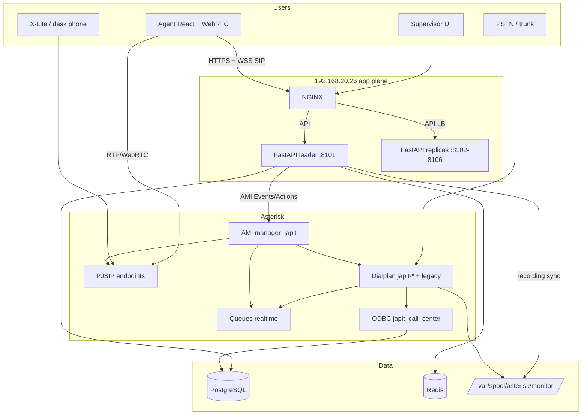
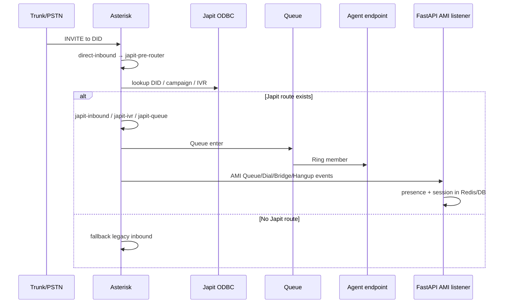
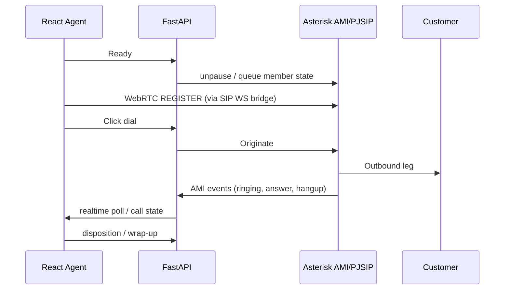
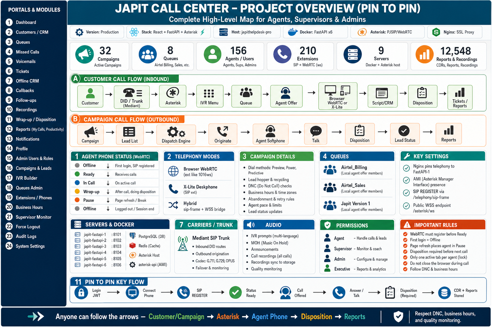

# Asterisk architecture — how Japit Call Center telephony works

## System context

## Inbound call flow

## Outbound / WebRTC agent flow

## Dialplan contexts (Japit)

Implemented primarily in `etc_asterisk/extensions_japit.conf` (included from `extensions.conf`):

| Context | Purpose |
|---------|---------|
| `japit-pre-router` | DID → Japit route or legacy fallback |
| `japit-inbound` | Inbound campaign entry |
| `japit-ivr` / `japit-ivr-default` / `japit-ivr-dispatch` | IVR menus |
| `japit-queue` | Queue delivery + AST-28 sticky preference (CURL then Queue()) |
| `japit-extension-route` | Direct extension |
| `japit-callback` | Callbacks |
| `japit-voicemail` | VM |
| `japit-app-outbound` | App-driven outbound |
| `japit-heartbeat` | Agent heartbeat hooks |
| `japit-recording-hangup` | Recording finalize events |
| `japit-rtp-qos-hangup` | AST-26 CHANNEL(rtpqos) UserEvent (Return only) |
| `japit-payment-start` | AST-27 PCI payment mode: PauseMixMonitor + no digit logging (Return only) |
| `japit-payment-end` | AST-27 resume MixMonitor only when `JAPIT_PAYMENT_SAFE=1` (Return only) |
| `japit-internal` | Internal routing |

## Control planes

| Plane | Mechanism | Consumer |
|-------|-----------|----------|
| Call control / presence | AMI (`manager_japit.conf`) | FastAPI leader only |
| Optional ARI | `ari_japit.conf` | tooling / future |
| Realtime queues | `extconfig` + Postgres tables | Asterisk + admin UI |
| Business data | ODBC funcs | Dialplan |

## Leader vs replicas (app side)

When FastAPI runs as Docker ×6:

- **Only fastapi-1** should run AMI listener, dispatch, recording sync, queue recovery
- Replicas serve HTTP API
- NGINX pins agent telephony + realtime poll + SIP WS to **8101**

See app Docker pack: `docs/DOCKER_FASTAPI_LB.md` / telephony RCA.

## Optional Asterisk-2 peer (manual operation)

AST-03 permits a second Asterisk peer with the same Git-managed configuration,
modules/codecs, realtime data, and shared media storage. Each PBX retains its
own SIP/RTP identity and node-local AMI ACL. FastAPI is manually pinned to one
AMI host at a time. This is not automatic HA: there is no Keepalived, SIP VIP,
automatic trunk failover, or automatic AMI failover. See
`docs/ASTERISK_PEER_DEPLOYMENT.md` and `peers/README.md`.

## Visual overview

*(File included when present on the source server.)*
