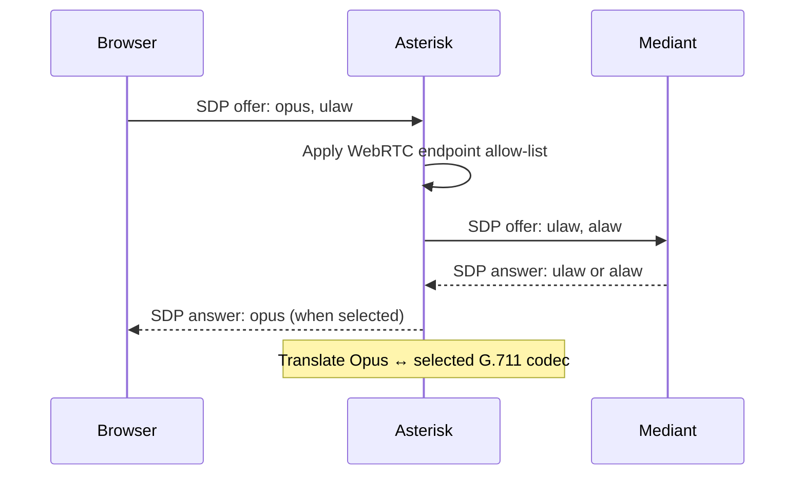
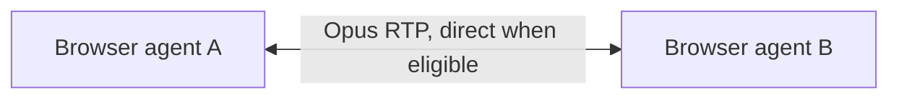
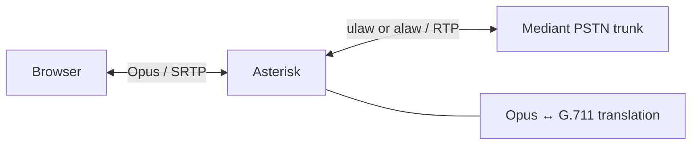

# Opus WebRTC Transcoding Policy (AST-02)

## Purpose and scope

AST-02 enables Opus for WebRTC agent endpoints while preserving the Mediant PSTN
trunk as G.711 (`ulaw,alaw`). This policy applies to call media negotiated by
Asterisk; it does not change carrier or Mediant codec settings.

## Media policy

| Call path | Preferred codec and path | Policy |
|---|---|---|
| Browser ↔ Browser | Opus end-to-end; direct media where network policy permits | Avoid Asterisk media relay and transcoding when both endpoints support Opus and direct RTP is reachable. |
| Browser ↔ SIP trunk (Mediant) | Opus on browser leg; `ulaw` or `alaw` on trunk leg | Asterisk stays in the RTP path and transcodes Opus ↔ G.711. `[Mediant]` must remain `allow=alaw,ulaw` and `direct_media=no`. |
| Agent ↔ Agent | Opus end-to-end; direct media where possible | Prefer direct media to minimize latency and CPU. Asterisk remains involved when NAT, recording, features, or network policy require it. |

Do not introduce a transcoder when both legs can use the same codec. In
particular, a browser-to-browser call that has been negotiated as Opus must not
be forced through `ulaw` merely because a PSTN trunk exists elsewhere in the
deployment.

## Codec negotiation flow

1. A browser offers codecs in SDP, normally including Opus and `ulaw`.
2. The WebRTC endpoint allow-list (`ASTERISK_WEBRTC_ALLOW_CODECS`, default
   `opus,ulaw`) limits the accepted offer.
3. Asterisk selects a common codec per media leg.
4. For a Mediant call, the trunk allow-list only admits `ulaw` and `alaw`.
   Asterisk creates an Opus ↔ G.711 translation path when the browser leg is
   Opus.
5. Confirm the actual result from SDP and the live channel; configured
   allow-lists alone do not prove a call was negotiated as Opus.



## RTP topology





Direct media is a per-call outcome, not a guarantee. NAT/TURN reachability,
recording, call features, and endpoint policy may keep RTP through Asterisk.
For Mediant calls, `direct_media=no` is intentional and required to retain the
translation and feature path.

## CPU and capacity expectations

An Opus passthrough call has only normal signaling and RTP forwarding costs.
An Opus ↔ G.711 call adds an Opus decode and encode workload at Asterisk.
Complexity `6` is a balanced production starting point; measure capacity on the
actual server because CPU cost varies with CPU generation, sample rate, packet
time, encryption, recording, and concurrent feature use.

Establish a G.711-only baseline first, then test at the expected peak
concurrency and observe Asterisk process CPU, system load, RTP quality, and
translation counts. Keep sustained CPU capacity headroom; do not promote a
100-call rollout if CPU saturation, packet loss, jitter, or MOS degradation is
observed. A sudden increase in Opus ↔ G.711 translations is expected only for
browser-to-trunk traffic and should be correlated with the
`japit_telephony_transcode_total` metric.

## Quality objective and measurement

The acceptance target is MOS **≥ 4.0** for successful test calls where a
measurement source reports MOS. Use the same source consistently within the
validation report:

- **Asterisk RTCP:** collect RTCP reports and channel statistics where the
  endpoint and Asterisk version expose them; record packet loss, jitter, RTT,
  and any reported quality estimate.
- **Softphone/browser:** capture the WebRTC `getStats()` audio inbound/outbound
  report, including jitter, packets lost, concealment, and available MOS/quality
  fields.
- **External probe:** use a calibrated RTP/WebRTC monitoring probe and record
  its methodology and both-leg results.

MOS is an estimate and is not universally emitted by Asterisk or browsers.
When no source reports MOS, record it as `not reported`, retain the underlying
loss/jitter/RTT evidence, and do not fabricate a score.

## CLI diagnostics

Run these on the Asterisk host during a controlled test call:

```text
core show codecs
core show translation
pjsip show endpoint {ext}ws
module show like opus
rtp set debug on
rtp set debug off
```

Inspect the INVITE/200 OK SDP for an Opus payload mapping (`a=rtpmap:... opus`)
on browser legs and `PCMU`/`PCMA` on Mediant legs. RTP debug can expose call
metadata and is verbose; enable it only for the isolated validation window and
disable it immediately after collection.

## 100-call validation report

Fill one row per call in the complete template at
[`../../Documents/PHASE2_AST02_OPUS_VALIDATION.md`](../../Documents/PHASE2_AST02_OPUS_VALIDATION.md)
and store the completed report with the deployment evidence. Summarize pass
rate, MOS distribution, peak CPU, packet-loss outliers, and any failed codec
negotiations.

## Rollback

1. Set WebRTC endpoint `allow` values back to `ulaw,alaw` (or the prior
   approved G.711 list).
2. Set `ASTERISK_WEBRTC_DIRECT_MEDIA=false`.
3. Reload the affected PJSIP configuration or perform the approved Asterisk
   restart procedure.
4. Verify with `pjsip show endpoint {ext}ws`, make a controlled call, and
   confirm its SDP contains only the expected G.711 codecs.
5. Retain the Opus module/configuration for investigation unless the approved
   change plan explicitly removes it.
